# Architecture

```mermaid
flowchart LR
    Source --> Lexer
    Lexer --> Layout[Layout context]
    Layout --> Parser[Grammar dispatch]
    Parser --> AST[Shared AST]
    AST --> Semantics[Symbols and types]
    Semantics --> IR[Typed three-address IR]
    IR --> Optimizer[Constant folding and dead code elimination]
    Optimizer --> Codegen[Bytecode generation]
    Codegen --> Artifact[Validated .pbc]
    Artifact --> VM[Stack VM]
    VM --> Output
    CLI --> Compiler[Shared compiler API]
    IDE --> Worker[Isolated worker]
    Worker --> Compiler
    Compiler --> Source
```

## Module interfaces

`Source` owns source text and spans; structured diagnostics reuse its location/excerpt objects. `lex(Source)` creates tokens. `Parser(Source, tokens).parse()` constructs a normalized `Node` tree and records recognition/layout events. The parser's suite reader drives a layout context stack because indentation cannot be interpreted correctly independently of brace/grammar context.

`Analyzer.analyze()` resolves lexical bindings, annotates AST expressions and statements, and produces symbol records. It collects top-level signatures first, checks source-ordered top-level statements, then checks function bodies. `Lowerer.lower()` emits typed functions with named temporaries and labels. `optimize_functions()` uses actual basic blocks, control-flow reachability, temporary liveness and next-use information to fold local constants, simplify constant branches and remove unreachable blocks/dead constant temporaries. `generate()` resolves labels and translates IR to stack instructions. `artifact.validate()` checks generated and loaded artifacts. `vm.run()` executes only bytecode.

`compile_source(source, filename, optimize=True)` returns `ok`, `diagnostics`, `stages`, and `artifact`. On failure, the artifact is null and only successfully completed stages are available. The AST panel includes resolved type/binding annotations after successful analysis. Runtime failures preserve compilation inspection data and partial output.

The CLI and web worker use this library directly. Web operations are `/api/check`, `/api/run`, `/api/build`, `/api/exec`, `/api/inspect`; requests contain source/filename, or artifact JSON text for exec. Run/exec optionally accept lower execution limits. Responses include diagnostics, stage representations and output; build also returns downloadable artifact text.

## Modular grammar dispatch

One Pratt parser handles expressions. Python-family, C-family and BASIC-family modules share expression, assignment, call, suite and control-flow handling. Dispatch uses leading tokens and bounded lookahead: `def`, `function`, type/name/parenthesis, `for (` versus `for name in`, exact built-in prefixes, and uppercase `LET`/`PRINT`.

Recognition stores family, candidate families, rule, source span, distinctive/shared flag and reasons. `int x = 3;` cannot distinguish C, C++ and Java and is recorded as shared. Distinctive prefixes such as `console.log`, `printf`, `LET` and `function` record their syntax evidence. Attribution does not select semantic rules. Deterministic dispatch avoids sequentially trying every language grammar. Approximately linear parsing is a design objective, not a benchmark result.

## Execution model

Each binding has a global or frame-local slot; each IR temporary has an additional frame-local slot. Recursive calls create fresh local storage and operand stacks. Calls evaluate arguments left to right. Source maps and excerpts live in the artifact, so diagnostics do not require opening source files.

Arrays normalize to `ArrayLiteral`, `ArrayNew`, `Index`, and `IndexAssign` nodes. Static analysis fixes their primitive element type and uses invariant array signatures. Explicit array IR lowers to dedicated, validated version 2 stack instructions. VM array objects share references across assignments/calls; accesses and writes enforce integer indexes, bounds and element types. Version 1 scalar artifacts remain supported.

Python-style array iteration uses a `ForEach` node with a typed, loop-local element binding. Lowering captures the array once, queries its length and emits an internal index loop using existing `ARRAY_GET`, comparison, branch and jump operations. This requires no new VM opcodes or artifact version. Continue targets the index update; assigning the loop variable does not modify the array.

The server binds only to loopback, checks Host/Origin, serves an explicit static-file allowlist, and launches spawned workers. A parent wall-clock deadline terminates runaway compilation/execution. This is a local educational tool, not a public multi-user hosting service.

## P1 extension points

Add a distinctive dispatch rule to the appropriate family module, normalize into existing AST nodes where semantics match, extend semantic checks only where necessary, and retain shared IR/VM operations. Never add separate language runtimes.

Implemented extensions: JavaScript `let`/`const`/`console.log` and annotated functions; restricted C `printf`; BASIC `LET`/`PRINT`. JavaScript declarations normalize to shared declaration nodes with inferred types and binding mutability. BASIC forms normalize to assignment/output. JavaScript functions normalize to the existing Function AST. Immutable bindings are checked by shared semantic analysis, including writes from other syntaxes.

Literal printf formats are parsed into explicit segments. Typed arguments evaluate once before output; formatting lowers to `FORMAT` instructions and common `OUTPUT`, with no C runtime. Artifact version 3 introduces this instruction and keeps versions 1/2 readable. Const is a source-level binding check, not a new VM storage class.

Same-scope BASIC labels/jumps remain deferred: they need label validation and control-flow definite-assignment analysis. Every future extension needs positive, negative and integration tests plus grammar/support-matrix changes.

## IR optimization

Optimization runs by default between typed lowering and bytecode generation. Original lowering output remains in `stages.ir`; the executed form is `stages.optimized_ir`, and `stages.optimization` reports actual pass counts. CLI `inspect --optimized-ir --optimization` exposes these results. `--no-optimize` (or the Boolean API option `optimize: false`) generates the original bytecode for comparison.

The pass uses a CFG built from entry, labels and post-terminator leaders. A backward worklist solves temporary liveness across successor blocks. Reverse next-use analysis distinguishes successive definitions and live-out values. Only validated primitive constants are tracked inside a block; facts do not flow through mutable storage or control-flow joins. Known expressions become typed CONST operations only when the exact VM-compatible result is finite and within value limits. A known Boolean branch becomes a JUMP. The graph is rebuilt to remove unreachable blocks, then liveness/next-use facts remove safe unused constant definitions.

Calls, stores, output, mutable loads, array operations and potentially trapping operations are retained whenever reachable. Division by zero, nonfinite results and failed conversions remain runtime operations with their original source diagnostics. Short-circuit behavior and source-level semantic checking remain intact. Lowering may append defensive return traps; optimization removes them only if unreachable.

The bounded pass handles up to 12 functions, 1,500 instructions per function, 3,000 instructions total and 120 blocks per analyzed function. Oversized functions retain their original IR and report the skip. The target remains a stack VM; no physical-register allocator, LLVM backend, DFA generator or alternate LR parser was introduced.
