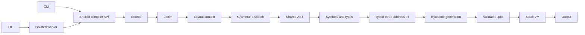

# Architecture

## Module interfaces

`Source` owns source text and spans; structured diagnostics reuse its location/excerpt objects. `lex(Source)` creates tokens. `Parser(Source, tokens).parse()` constructs a normalized `Node` tree and records recognition/layout events. The parser's suite reader drives a layout context stack because indentation cannot be interpreted correctly independently of brace/grammar context.

`Analyzer.analyze()` resolves lexical bindings, annotates AST expressions and statements, and produces symbol records. It collects top-level signatures first, checks source-ordered top-level statements, then checks function bodies. `Lowerer.lower()` emits typed functions with named temporaries and labels. `generate()` resolves labels and translates IR to stack instructions. `artifact.validate()` checks generated and loaded artifacts. `vm.run()` executes only bytecode.

`compile_source(source, filename)` returns `ok`, `diagnostics`, `stages`, and `artifact`. On failure, the artifact is null and only successfully completed stages are available. The AST panel includes resolved type/binding annotations after successful analysis. Runtime failures preserve compilation inspection data and partial output.

The CLI and web worker use this library directly. Web operations are `/api/check`, `/api/run`, `/api/build`, `/api/exec`, `/api/inspect`; requests contain source/filename, or artifact JSON text for exec. Run/exec optionally accept lower execution limits. Responses include diagnostics, stage representations and output; build also returns downloadable artifact text.

## Modular grammar dispatch

One Pratt parser handles expressions. Python-family and C-family modules share expression, assignment, call, suite and control-flow handling. Dispatch uses leading tokens and bounded lookahead: `def`, type/name/parenthesis, `for (` versus `for name in`, and exact built-in prefixes.

Recognition stores family, candidate families, rule, source span, distinctive/shared flag and reasons. `int x = 3;` cannot distinguish C++ from Java and is recorded as shared. Attribution does not select semantic rules. Deterministic dispatch avoids sequentially trying every language grammar. Approximately linear parsing is a design objective, not a benchmark result.

## Execution model

Each binding has a global or frame-local slot; each IR temporary has an additional frame-local slot. Recursive calls create fresh local storage and operand stacks. Calls evaluate arguments left to right. Source maps and excerpts live in the artifact, so diagnostics do not require opening source files.

The server binds only to loopback, checks Host/Origin, serves an explicit static-file allowlist, and launches spawned workers. A parent wall-clock deadline terminates runaway compilation/execution. This is a local educational tool, not a public multi-user hosting service.

## P1 extension points

Add a distinctive dispatch rule to the appropriate family module, normalize into existing AST nodes where semantics match, extend semantic checks only where necessary, and retain shared IR/VM operations. Never add separate language runtimes.

Planned order: JavaScript `let`/`console.log`, restricted C `printf`, BASIC `LET`/`PRINT`, annotated JavaScript functions, then same-scope BASIC labels/jumps. `const` needs shared binding mutability checks; GOTO needs label validation and control-flow definite-assignment analysis. None are enabled in this release. Every extension needs positive, negative and integration tests plus grammar/support-matrix changes.
